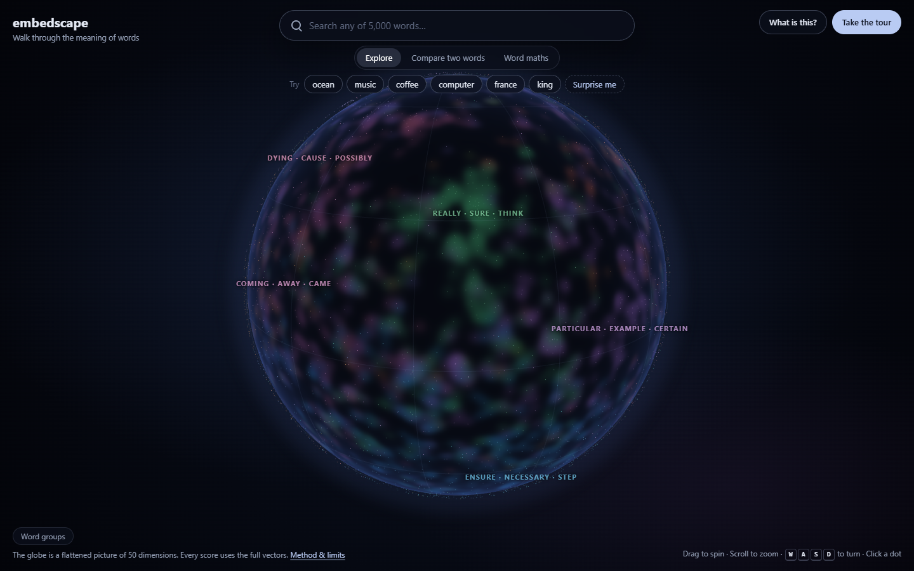
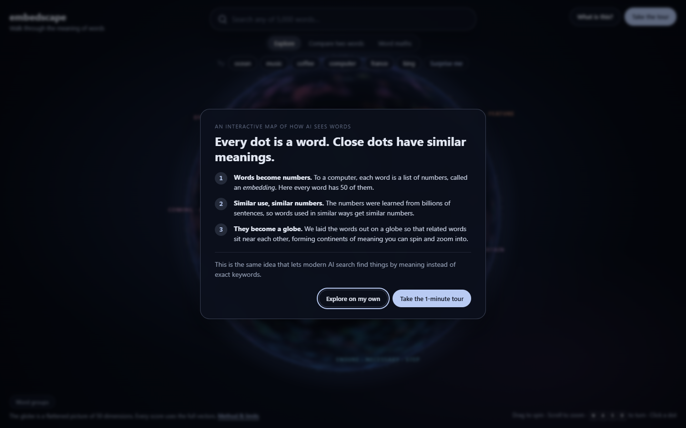
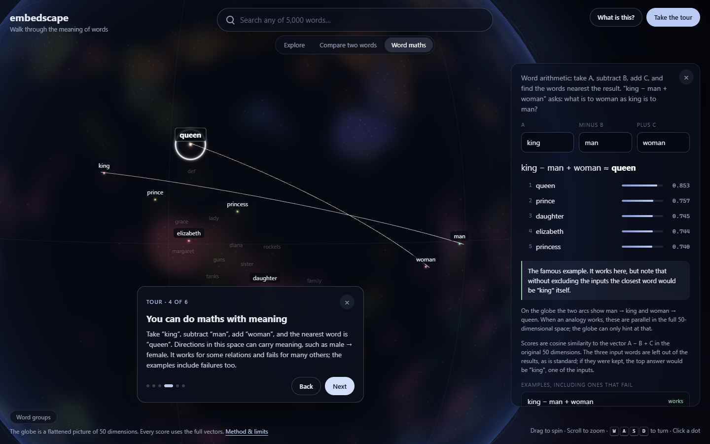
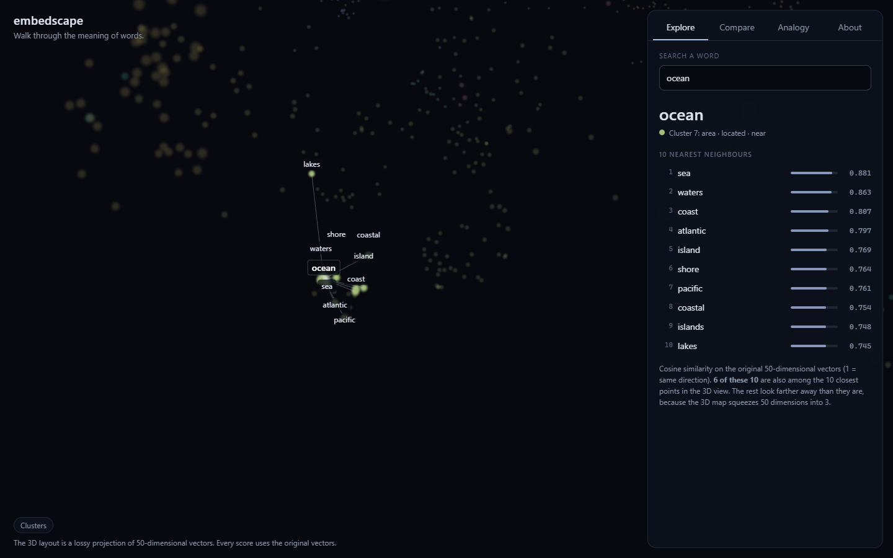
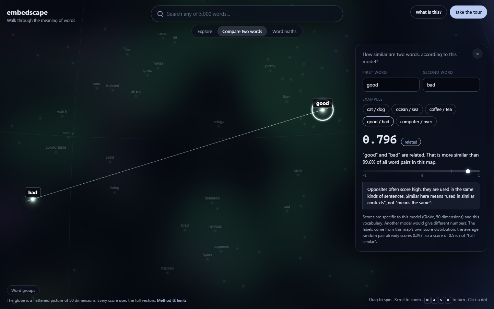
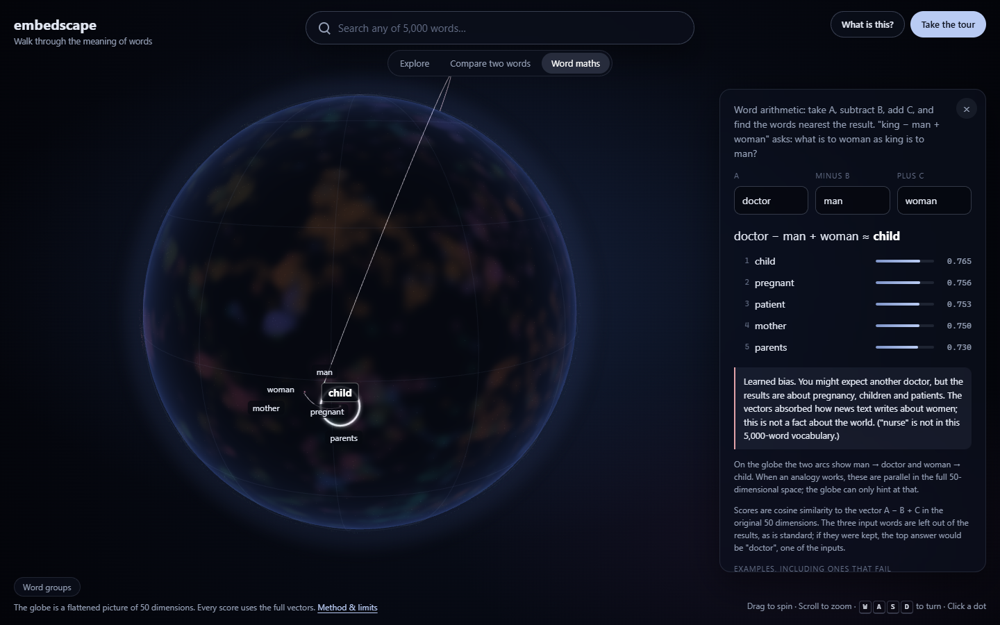
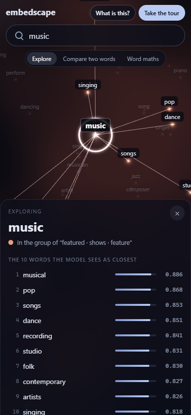
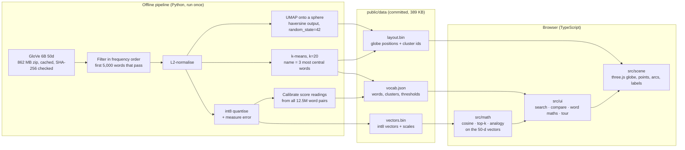

# embedscape

**Walk through the meaning of words.**

A 3D globe of 5,000 common English words, laid out so that words with similar meanings sit near each
other and form "continents" of meaning. You can spin the globe, search a word and fly to it, see its
nearest neighbours, compare two words and try word arithmetic. A guided tour explains it all in about a
minute. The aim is to make *embeddings*, the idea behind modern AI search, something a non-expert can
see and explore, and to be honest about what they get wrong.

It is a static site: no backend, no API keys, no tracking. Everything runs in the browser.



| A plain-English welcome | The guided tour (king − man + woman) |
|---|---|
|  |  |

| Exploring "ocean" | Compare (opposites score high) | Word maths showing learned bias | Phone |
|---|---|---|---|
|  |  |  |  |

*Screenshots are real captures of the production build, made by `e2e/screenshots.spec.ts`.*

---

## Features

- **Explains itself.** A first-visit welcome says what embeddings are in three plain steps. A one-minute
  **guided tour** flies the camera through the core ideas: similar words live together, closeness is a
  number, you can do maths with meaning, and the model learned our biases. Every number in the tour is
  computed live from the data.
- **The word globe.** 5,000 glowing words on a sphere.
  - The coloured "continents" are a density map of where each group's words actually sit, and each
    group's name floats over its most central word.
  - Drag or use the arrow / W A S D keys to spin, and scroll or Q / E to zoom.
  - As you get close to the surface, nearby words label themselves.
  - Words on the far side are hidden, and the camera flies over the curve of the globe.
- **Search with autocomplete.** Picking a word flies to it, lists its **10 nearest neighbours with cosine
  scores** and draws them as arcs over the globe. It is an accessible combobox (arrow keys, Enter, `/`
  to focus). Deep links work, for example `#word=ocean`.
- **Projection check.** For every word, the card says how many of its 10 true neighbours are also among its
  10 closest dots on the globe. This shows directly that the picture loses information.
- **Compare two words.** The card shows the cosine score, a plain-English reading (very close, related,
  loosely related or unrelated) and "more similar than X% of word pairs". Thresholds are **measured from
  this vocabulary**, not invented.
- **Word maths.** `A − B + C = ?` shows the top 5 results, excluding the inputs, with scores.
  - Eight presets are included, each checked by a test: five work, two fail, and one shows learned
    gender bias.
  - The card also says what the answer would be *without* excluding the inputs, which is often just one
    of the inputs.
- **Method & limits** dialog: how it was built, measured numbers, limits and credits.
- Works without WebGL: the globe is hidden, and every number and panel still works, because none of them
  depend on it.

## How it works



**The key rule:** every similarity, neighbour and analogy result is computed on the **original
50-dimensional vectors**, never on the globe positions. The globe is only a picture.

UMAP's haversine output metric places the words directly on the surface of a sphere, rather than
squashing a flat map onto one afterwards. Close neighbourhoods stay roughly intact, while long
distances, where a continent sits, and the latitude and longitude lines mean nothing. The site says so
in a note that is always visible.

## Data and licences

| What | Source | Licence |
|---|---|---|
| Word vectors | [GloVe 6B](https://nlp.stanford.edu/projects/glove/) (Wikipedia 2014 + Gigaword 5, 400k lowercase words), 50 dimensions, by Jeffrey Pennington, Richard Socher and Christopher D. Manning | [ODC PDDL v1.0](https://opendatacommons.org/licenses/pddl/1-0/) (licence statement checked on the GloVe page) |
| Offensive-word list | [LDNOOBW](https://github.com/LDNOOBW/List-of-Dirty-Naughty-Obscene-and-Otherwise-Bad-Words) English list, pinned commit `5faf2ba`, plus [a small supplement](pipeline/blocklist/supplement.txt) | CC BY 4.0 / MIT |
| Code | This repository | MIT |

Citation: Jeffrey Pennington, Richard Socher, and Christopher D. Manning. 2014. *GloVe: Global Vectors
for Word Representation.* EMNLP.

The raw vector file is **not** committed. `pipeline/build_data.py` downloads it once into
`pipeline/.cache/` (gitignored). The download resumes if the connection drops and is accepted only if
its size and SHA-256 match.

### Which words are included

GloVe's file is ordered by corpus frequency; its first rows are `the , . of to and in a`. The pipeline
walks it in that order and keeps the first 5,000 tokens that pass every rule. That took **5,661 rows**,
and the 5,000th word kept is *nicolas*.

| Rule (checked in this order) | Removed |
|---|---:|
| Not all lowercase `a–z` (numbers, punctuation, hyphens, accents) | 330 |
| Shorter than 3 letters (fragments like `mr`, `st`; also real words like `go`, `tv`) | 93 |
| English stop word (scikit-learn's list: `the`, `of`, `with`, …) | 234 |
| On the blocklist (exact token or simple plural) | 4 |

**Categories the blocklist removes:** profanity and vulgar terms; sexual and sexually explicit terms;
racial, ethnic, religious, homophobic, transphobic and ableist slurs. Matching is exact, never by
substring, so innocent words that *contain* a listed string are kept. A few words with common neutral
meanings were deliberately left out of the supplement, for example *cracker* and *queer*. The reasons are
in [pipeline/blocklist/README.md](pipeline/blocklist/README.md).

## Measured numbers

Unless noted, values come from [`pipeline/stats.json`](pipeline/stats.json), written by the build.

**Quantisation** (symmetric per-vector int8 on unit vectors, re-normalised in the browser):

| Measure | Value |
|---|---|
| Max absolute error per component | 0.0032 |
| Max change in any pairwise cosine score (12.5M pairs) | 0.0083 |
| Mean change in pairwise cosine score | 0.0011 |
| Top-10 neighbours shared with full precision (mean) | 98.75% |
| Words whose top-10 list is in exactly the same order | 49.6% (near-ties swap places) |

**Compare thresholds** (from the real score distribution):

| Reading | Rule | Value |
|---|---|---|
| very close | ≥ median similarity between a word and its single nearest neighbour | 0.851 |
| related | ≥ 99th percentile of all word pairs | 0.688 |
| loosely related | ≥ 90th percentile of all word pairs | 0.513 |
| unrelated | below that | |

The *average* random pair already scores **0.297**, which is why raw cosine numbers mislead without
calibration.

**How faithful is the globe?** For each word, the test counts how many of its 10 true neighbours (in 50
dimensions) are also among its 10 closest dots in the picture, then averages over all 5,000 words. This
was a side-by-side test run during development; the shipped value was re-measured on the committed data.

| Layout | Mean overlap (out of 10) |
|---|---:|
| Free 3D point cloud (UMAP, 3 components), an earlier version | 3.52 |
| Globe with UMAP's default spacing (`min_dist=0.1`, 15 neighbours) | 1.33 |
| **Globe as shipped** (`min_dist=0`, 10 neighbours) | **2.08** |

The globe is an honest trade-off: a sphere's surface is effectively 2D, so it keeps fewer true neighbours
together than a free 3D cloud. Tighter UMAP settings recovered most of the gap. This is why every number
on the site comes from the 50-d vectors, and why the per-word count is shown.

**Clusters:** the cosine silhouette score is low at every k tried (8: 0.094, 12: 0.100, 16: 0.101,
20: 0.108, 24: 0.112, 32: 0.104). Word meaning does not form clean groups, and the clusters are soft. k=20 was
chosen over the marginally higher 24 so the colours stay distinguishable.

**Download size** of the production build (`dist/`), measured:

| File | Raw | gzip -9 |
|---|---:|---:|
| JavaScript (almost all three.js) | 609 KB | 154 KB |
| `vectors.bin` | 270 KB | 245 KB |
| `layout.bin` | 65 KB | 60 KB |
| `vocab.json` | 54 KB | 21 KB |
| CSS + HTML | 20 KB | 6 KB |
| **Total** | **1,018 KB** | **486 KB** |

The quantised vectors barely compress, because they are close to random bytes. The actual transfer
depends on the host's compression. The globe's coloured surface is drawn in the browser from the word
positions, so it adds no download.

**Reproducibility:** two full builds of the globe on the same machine produced byte-identical `vectors.bin`, `layout.bin` and `vocab.json`. UMAP output can still differ across operating systems or library
versions, which is why the versions used are pinned and recorded in `stats.json`.

## Run it locally

Requirements: Node 22+, and Python 3.11+ only if you want to rebuild the data.

```bash
npm ci
npm run dev          # http://localhost:5173/embedscape/
```

Production build and preview:

```bash
npm run build
npm run preview      # http://localhost:4173/embedscape/
```

### Rebuild the data (optional)

The committed files in `public/data/` are what the site uses. To regenerate them:

```bash
cd pipeline
python -m venv .venv
# Windows: .venv\Scripts\activate    macOS/Linux: source .venv/bin/activate
pip install -r requirements-dev.txt
python build_data.py                 # downloads ~862 MB once, then writes ../public/data and stats.json
```

On Windows, keep the venv at a short path such as `pipeline/.venv`. scikit-learn ships deeply nested files
that can exceed the 260-character path limit.

Options: `--n-words`, `--k`, `--seed`, `--no-silhouette-scan`. After the download, a full build took
1 to 2 minutes on a laptop CPU, most of it UMAP. The first run is slower, while numba compiles.

## Tests

| Suite | Command | What it covers |
|---|---|---|
| Pipeline (pytest, 24 tests) | `cd pipeline && pytest` | Filter rules, blocklist matching, quantisation error bound, binary round-trip, globe mapping, cluster naming rule, threshold ordering, end-to-end determinism. Uses synthetic data and never downloads. |
| Front end (Vitest, 29 tests) | `npm test` | Cosine, top-k against brute force, analogy exclusion, score readings, percentile, autocomplete, binary decoding, colours. **Also every claim in the preset notes, checked against the shipped data,** and that every word sits on the globe. |
| Browser (Playwright, 4 tests) | `npx playwright test` | Builds and serves the production site. Checks the welcome dialog and the full tour, the CSP, WebGL, search → 10 neighbours, compare, word maths, the Method & limits credits, a deep link, no sideways scroll on a phone, and no console errors or CSP violations. One test turns WebGL off and checks that the panels still work. |

Run `npx playwright install chromium` once before the browser tests.
`SCREENSHOTS=1 npx playwright test screenshots` regenerates the README screenshots.

## Deploy

[`.github/workflows/deploy.yml`](.github/workflows/deploy.yml) runs all three test suites on every push
and pull request. On `main`, it then builds and deploys `dist/` to GitHub Pages. To enable it, go to
**Settings → Pages → Source: GitHub Actions**. The workflow builds the site for the repository's own
path (for example `/Embedscape/`). Local builds default to `/embedscape/`; set `BASE_PATH=/` when
building for a host that serves from the root.

CI does not rerun the data pipeline, because of the 862 MB download. It uses the committed data files.

## Security and privacy

- A Content-Security-Policy meta tag is added to production builds:
  `default-src 'self'; script-src 'self'; style-src 'self'; img-src 'self' data:; connect-src 'self'; font-src 'self'; object-src 'none'; base-uri 'self'; form-action 'none'`.
  The browser tests fail on any CSP violation.
- No external requests at runtime, no cookies, no analytics. What you type never leaves the page.
  `localStorage` only remembers that you have seen the welcome dialog.
- User-visible text is set with `textContent`, never `innerHTML`.
- There are no secrets, so there is no `.env` or `.env.example`.

## Limitations

- **Similar means "used in similar contexts", not "same meaning".** Opposites such as good and bad
  (0.796) score as related.
- **Bias.** The vectors learned from 2014 Wikipedia and news text and carry its stereotypes. The site
  shows one case (`doctor − man + woman`) and does not try to hide or "fix" it.
- **Analogies are fragile.** Several classic ones work, but many fail, as two presets show. Excluding the
  input words, which is standard practice, makes results look better than they are; the card shows this.
- **One vector per word.** Senses are mixed together, so *bank* (river) and *bank* (money) are one point.
- **Small, old model.** 50 dimensions, a 400k vocabulary trained in 2014, and only the 5,000 most common
  filtered words shown. Rare words, names outside the top rows, and words under 3 letters are missing.
  Modern embedding models are much larger and context-aware. This one was chosen because it is openly
  licensed and small enough to explore in a browser.
- **The globe distorts.** On average only about 2 of a word's 10 true neighbours are also its closest
  dots on the globe (see the table above). Where a continent sits, and the distance between continents,
  mean nothing. The card reports the exact count for each word.
- **Cluster names** come from a mechanical rule (the 3 most central words), so some read oddly, such as
  "area · located · near". That is the honest result of the rule.
- **The blocklist is not complete.** Exact matching cannot catch context, misspellings or new slurs.
- **Accessibility.** Search and tabs follow the standard ARIA combobox and tabs patterns and work from the
  keyboard. They have not been tested with a real screen reader. The globe itself is visual, but
  everything it shows is also available as text in the cards.

## Project structure

```
src/
  data/load.ts        decode vectors.bin / layout.bin / vocab.json
  math/               vectors (cosine, top-k, analogy), compare, search, projection, colours
  scene/              three.js globe: points shader, continent texture, arcs, labels, camera flights
  ui/                 combobox, explore / compare / word-maths cards, guided tour, method dialog
  presets.ts          preset examples (claims verified by tests/realData.test.ts)
tests/                Vitest unit tests and real-data tests
e2e/                  Playwright browser tests and screenshot capture
pipeline/
  build_data.py       entry point
  embedscape_pipeline/ download, filters, quantize, layout (globe), clusters, calibrate, export
  blocklist/          LDNOOBW list, supplement, policy README
  stats.json          the measured numbers quoted above
  tests/              pytest
public/data/          the generated files the site loads
```

## Licence

Code: [MIT](LICENSE). Word vectors: GloVe, PDDL v1.0. Blocklist: LDNOOBW, CC BY 4.0. See [LICENSE](LICENSE)
for the third-party notices.
