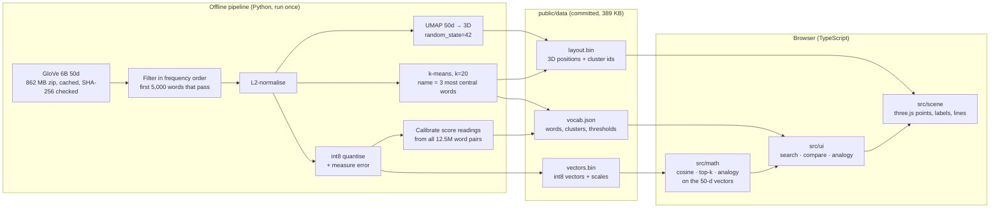

# embedscape

**Walk through the meaning of words.**

An interactive 3D map of 5,000 common English words, where words with similar meanings sit near each
other. Search a word and fly to it, see its nearest neighbours, compare two words, and try word
analogies. The goal is to make *embeddings*, the idea behind modern AI search, something you can see
and poke at. It is also honest about what they get wrong.

It is a static site: no backend, no API keys, no tracking. Everything runs in the browser.


| Compare (opposites score high) | Analogy (a preset that shows learned bias) | Phone |
|---|---|---|
|  |  |  |

*Screenshots are real captures of the production build, made by `e2e/screenshots.spec.ts`.*

---

## Features

- **3D word map.** 5,000 words drawn as points in one WebGL draw call, with a soft depth fog. You can
  orbit, zoom and use touch. Points are coloured by cluster. Only the focused word and its neighbours get
  labels, and labels that would overlap are nudged apart.
- **Search with autocomplete.** An accessible combobox: arrow keys, Enter, and `/` to focus it. Picking a
  word flies the camera to it, lists its **10 nearest neighbours with cosine scores** and draws lines to
  them. Deep links work, for example `#word=ocean`.
- **Projection check.** For every word, the panel says how many of its 10 true neighbours are also among the
  10 closest points *in 3D*. This shows directly that the picture loses information.
- **Compare two words.** The panel shows the cosine score, a plain-English reading (very close, related,
  loosely related or unrelated) and "more similar than X% of word pairs". Thresholds are **measured from
  this vocabulary**, not invented.
- **Analogy playground.** `A − B + C = ?` shows the top 5 results, excluding the inputs, with scores. Eight
  presets are included, and every one is checked by a test. Five work, two fail, and one shows learned
  gender bias. The panel also says what the answer would be *without* excluding the inputs, which is
  often just one of the inputs.
- **About panel.** Explains what embeddings are, how to read the map, measured build numbers, limits,
  and credits.
- Works without WebGL: the 3D view is hidden, and every number and panel still works, because none of
  them depend on it.

## How it works



**The key rule:** every similarity, neighbour and analogy result is computed on the **original
50-dimensional vectors**, never on the 3D positions. The 3D layout is only a picture. UMAP keeps local
neighbourhoods roughly intact but distorts long distances, and the site says so in a note that is
always visible.

## Data and licences

| What | Source | Licence |
|---|---|---|
| Word vectors | [GloVe 6B](https://nlp.stanford.edu/projects/glove/) (Wikipedia 2014 + Gigaword 5, 400k lowercase words), 50 dimensions, by Jeffrey Pennington, Richard Socher and Christopher D. Manning | [ODC PDDL v1.0](https://opendatacommons.org/licenses/pddl/1-0/) (licence statement checked on the GloVe page) |
| Offensive-word list | [LDNOOBW](https://github.com/LDNOOBW/List-of-Dirty-Naughty-Obscene-and-Otherwise-Bad-Words) English list, pinned commit `5faf2ba`, plus [a small supplement](pipeline/blocklist/supplement.txt) | CC BY 4.0 / MIT |
| Code | This repository | MIT |

Citation: Jeffrey Pennington, Richard Socher, and Christopher D. Manning. 2014. *GloVe: Global Vectors
for Word Representation.* EMNLP.

The raw vector file is **not** committed. `pipeline/build_data.py` downloads it once into
`pipeline/.cache/` (gitignored). The download resumes if the connection drops and is accepted only if
its size and SHA-256 match.

### Which words are included

GloVe's file is ordered by corpus frequency; its first rows are `the , . of to and in a`. The pipeline
walks it in that order and keeps the first 5,000 tokens that pass every rule. That took **5,661 rows**,
and the 5,000th word kept is *nicolas*.

| Rule (checked in this order) | Removed |
|---|---:|
| Not all lowercase `a–z` (numbers, punctuation, hyphens, accents) | 330 |
| Shorter than 3 letters (fragments like `mr`, `st`; also real words like `go`, `tv`) | 93 |
| English stop word (scikit-learn's list: `the`, `of`, `with`, …) | 234 |
| On the blocklist (exact token or simple plural) | 4 |

**Categories the blocklist removes:** profanity and vulgar terms; sexual and sexually explicit terms;
racial, ethnic, religious, homophobic, transphobic and ableist slurs. Matching is exact, never by
substring, so innocent words that *contain* a listed string are kept. A few words with common neutral
meanings were deliberately left out of the supplement, for example *cracker* and *queer*. The reasons are
in [pipeline/blocklist/README.md](pipeline/blocklist/README.md).

## Measured numbers

All values come from [`pipeline/stats.json`](pipeline/stats.json), written by the build.

**Quantisation** (symmetric per-vector int8 on unit vectors, re-normalised in the browser):

| Measure | Value |
|---|---|
| Max absolute error per component | 0.0032 |
| Max change in any pairwise cosine score (12.5M pairs) | 0.0083 |
| Mean change in pairwise cosine score | 0.0011 |
| Top-10 neighbours shared with full precision (mean) | 98.75% |
| Words whose top-10 list is in exactly the same order | 49.6% (near-ties swap places) |

**Compare thresholds** (from the real score distribution):

| Reading | Rule | Value |
|---|---|---|
| very close | ≥ median similarity between a word and its single nearest neighbour | 0.851 |
| related | ≥ 99th percentile of all word pairs | 0.688 |
| loosely related | ≥ 90th percentile of all word pairs | 0.513 |
| unrelated | below that | |

The *average* random pair already scores **0.297**, which is why raw cosine numbers mislead without
calibration.

**Clusters:** the cosine silhouette score is low at every k tried (8: 0.094, 12: 0.100, 16: 0.101,
20: 0.108, 24: 0.112, 32: 0.104). Word meaning does not form clean groups, and the clusters are soft. k=20 was
chosen over the marginally higher 24 so the colours stay distinguishable.

**Download size** of the production build (`dist/`), measured:

| File | Raw | gzip -9 |
|---|---:|---:|
| JavaScript (almost all three.js) | 586 KB | 147 KB |
| `vectors.bin` | 270 KB | 245 KB |
| `layout.bin` | 65 KB | 60 KB |
| `vocab.json` | 54 KB | 21 KB |
| CSS + HTML | 11 KB | 4 KB |
| **Total** | **985 KB** | **477 KB** |

The quantised vectors barely compress, because they are close to random bytes. The actual transfer
depends on the host's compression.

**Reproducibility:** three full builds on the same machine produced byte-identical `vectors.bin` and
`layout.bin`. UMAP output can still differ across operating systems or library versions, which is why
the versions used are pinned and recorded in `stats.json`.

## Run it locally

Requirements: Node 22+, and Python 3.11+ only if you want to rebuild the data.

```bash
npm ci
npm run dev          # http://localhost:5173/embedscape/
```

Production build and preview:

```bash
npm run build
npm run preview      # http://localhost:4173/embedscape/
```

### Rebuild the data (optional)

The committed files in `public/data/` are what the site uses. To regenerate them:

```bash
cd pipeline
python -m venv .venv
# Windows: .venv\Scripts\activate    macOS/Linux: source .venv/bin/activate
pip install -r requirements-dev.txt
python build_data.py                 # downloads ~862 MB once, then writes ../public/data and stats.json
```

On Windows, keep the venv at a short path such as `pipeline/.venv`. scikit-learn ships deeply nested files that can exceed the 260-character path limit.

Options: `--n-words`, `--k`, `--seed`, `--no-silhouette-scan`. A full build took roughly 2 to 8 minutes
on a laptop CPU, almost all of it UMAP. The time varied with machine load.

## Tests

| Suite | Command | What it covers |
|---|---|---|
| Pipeline (pytest, 23 tests) | `cd pipeline && pytest` | Filter rules, blocklist matching, quantisation error bound, binary round-trip, cluster naming rule, threshold ordering, end-to-end determinism. Uses synthetic data and never downloads. |
| Front end (Vitest, 28 tests) | `npm test` | Cosine, top-k against brute force, analogy exclusion, score readings, percentile, autocomplete, binary decoding, colours. **Also every claim in the preset notes, checked against the shipped data.** |
| Smoke (Playwright, 3 tests) | `npx playwright test` | Builds and serves the production site. Then checks the CSP is present, WebGL starts, search → 10 neighbours, compare, analogy, the About credits, a deep link, no sideways scroll on a phone, and no console errors or CSP violations. A third test turns WebGL off and checks that the panels still work. |

Run `npx playwright install chromium` once before the smoke tests.
`SCREENSHOTS=1 npx playwright test screenshots` regenerates the README screenshots.

## Deploy

[`.github/workflows/deploy.yml`](.github/workflows/deploy.yml) runs all three test suites on every push
and pull request. On `main`, it then builds and deploys `dist/` to GitHub Pages. To enable it, go to
**Settings → Pages → Source: GitHub Actions**. The site expects to be served from `/embedscape/`; set
`BASE_PATH=/` when building for a different host.

CI does not rerun the data pipeline, because of the 862 MB download. It uses the committed data files.

## Security and privacy

- A Content-Security-Policy meta tag is added to production builds:
  `default-src 'self'; script-src 'self'; style-src 'self'; img-src 'self' data:; connect-src 'self'; font-src 'self'; object-src 'none'; base-uri 'self'; form-action 'none'`.
  The smoke test fails on any CSP violation.
- No external requests at runtime, no cookies, no analytics. What you type never leaves the page.
- User-visible text is set with `textContent`, never `innerHTML`.
- There are no secrets, so there is no `.env` or `.env.example`.

## Limitations

- **Similar means "used in similar contexts", not "same meaning".** Opposites such as good and bad
  (0.796) score as related.
- **Bias.** The vectors learned from 2014 Wikipedia and news text and carry its stereotypes. The site
  shows one case (`doctor − man + woman`) and does not try to hide or "fix" it.
- **Analogies are fragile.** Several classic ones work, but many fail, as two presets show. Excluding the
  input words, which is standard practice, makes results look better than they are; the panel shows this.
- **One vector per word.** Senses are mixed together, so *bank* (river) and *bank* (money) are one point.
- **Small, old model.** 50 dimensions, a 400k vocabulary trained in 2014, and only the 5,000 most common
  filtered words shown. Rare words, names outside the top rows, and words under 3 letters are missing.
  Modern embedding models are much larger and context-aware. This one was chosen because it is openly
  licensed and small enough to explore in a browser.
- **The 3D layout distorts.** Long distances and cluster positions in the picture mean little. For a
  typical word only some of its true neighbours are also its nearest neighbours in 3D, and the panel
  reports the exact count.
- **Cluster names** come from a mechanical rule (the 3 most central words), so some read oddly, such as
  "area · located · near". That is the honest result of the rule.
- **The blocklist is not complete.** Exact matching cannot catch context, misspellings or new slurs.
- **Accessibility.** Search and tabs follow the standard ARIA combobox and tabs patterns and work from the
  keyboard. They have not been tested with a real screen reader. The 3D map itself is visual, but
  everything it shows is also available as text in the panels.

## Project structure

```
src/
  data/load.ts        decode vectors.bin / layout.bin / vocab.json
  math/               vectors (cosine, top-k, analogy), compare, search, projection, colours
  scene/              three.js explorer (points shader, camera flight, labels, lines)
  ui/                 combobox and the four panels
  presets.ts          preset examples (claims verified by tests/realData.test.ts)
tests/                Vitest unit tests and real-data tests
e2e/                  Playwright smoke test and screenshot capture
pipeline/
  build_data.py       entry point
  embedscape_pipeline/ download, filters, quantize, layout, clusters, calibrate, export
  blocklist/          LDNOOBW list, supplement, policy README
  stats.json          every measured number quoted above
  tests/              pytest
public/data/          the generated files the site loads
```

## Licence

Code: [MIT](LICENSE). Word vectors: GloVe, PDDL v1.0. Blocklist: LDNOOBW, CC BY 4.0. See [LICENSE](LICENSE)
for the third-party notices.
